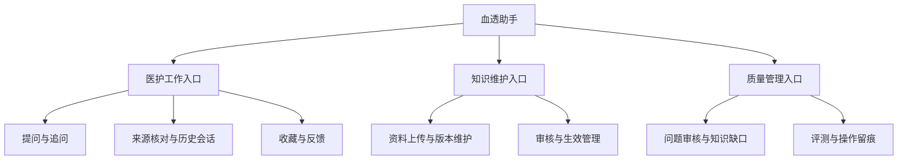
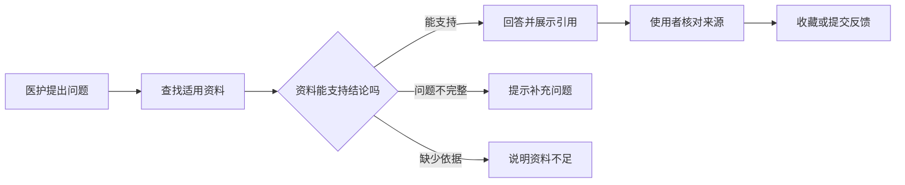
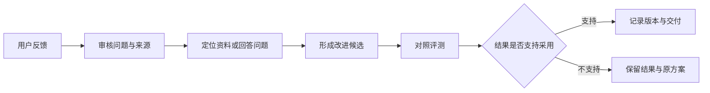

# 血透助手｜让制度问答有据可查

**面向血液透析机构医护人员的知识辅助项目：把分散的制度资料，转成带来源、可核对、可反馈的工作问答。**

这是一份面向招聘方与技术面试官的项目展示。项目由个人主导，AI 工具辅助实现、测试与文档整理；源码在私有仓库维护。

## 30 秒了解项目

医护人员在培训、日常工作和制度核对中，经常需要确认“这项要求是什么、适用于谁、依据在哪份文件”。只给一个流畅的答案还不够：旧版本、适用条件和资料缺失都会影响结论。

血透助手围绕这三个问题设计：

| 使用者关心什么 | 产品提供什么 |
| --- | --- |
| 能否快速找到相关规定 | 用自然语言提问，并结合会话上下文继续追问 |
| 这句话依据在哪里 | 展示答案引用和来源位置，便于回看核对 |
| 查不到或问法有误怎么办 | 给出资料不足、澄清或纠错提示 |
| 制度更新后如何维护 | 管理资料版本、审核状态和适用范围 |
| 回答有问题如何改进 | 收集反馈，进入审核与评测闭环 |

## 产品能力全景

## 一次问答如何发生

以下只是虚构演示情境，不代表任何机构的真实制度：

| 情境 | 希望呈现的行为 | 演示时看什么 |
| --- | --- | --- |
| 询问新员工岗前培训要求 | 根据已收录资料作答 | 展开引用，检查来源位置 |
| 继续问“没通过怎么办” | 结合上下文理解追问 | 是否仍围绕原问题 |
| 询问资料未涵盖的报销比例 | 说明缺少依据 | 是否避免编造比例和引用 |

## 我做出的四个产品选择

**先限定知识范围。** 首先解决机构制度和培训资料查询，控制资料来源、版本和适用条件，让问题边界可以检查。

**把来源放进交互。** 答案旁边提供引用，用户可以沿着来源核对；带引用仍需要检查结论是否被原文支持。

**给失败明确出口。** 把回答、澄清、资料不足等结果分开呈现。系统查不到依据时，使用者应知道下一步补什么。

**用评测决定是否采用改动。** 召回更多、回答更多都只是局部现象；是否采用，还要看不该回答的问题、引用质量和调用成本。

## 从反馈到改进

## 这份作品能说明哪些能力

| 能力 | 可在面试中展开的内容 |
| --- | --- |
| 业务理解 | 为什么制度查询需要版本、适用条件和来源核对 |
| 产品设计 | 如何设计问答终态、资料审核流程和管理入口 |
| AI 方案判断 | 如何权衡检索覆盖、回答质量、拒答和成本 |
| 评测设计 | 为什么要固定题集、比较基线、保留失败实验 |
| 工程交付 | 如何串起界面、服务、持久化、测试与版本记录 |

个人主导的内容包括需求范围、产品流程、验收口径、方案取舍与交付组织；AI 工具参与代码、测试、诊断和材料整理。面试时可结合具体提交和演示继续说明分工。

## 当前进展与成果口径

更新日期：**2026-11-19**。

- 已有制度问答、引用核对、会话历史、资料管理、账号与角色管理、反馈审核、评测管理和操作审计等实现。
- 项目已有 **v0.1.4 发布与部署记录**。该版本记录与后续主线开发分开管理；本页更新属于展示材料同步。
- 保留虚构资料的确定性 Demo 路径，便于演示问答流程；真实模型链路和特定评测结果按各自配置核验。
- 历史实验使用过不同题集、模型和评分口径。本页不把局部样本结果汇总成“系统准确率”，也不编造真实用户规模、节省工时或业务收益。

它用于机构知识检索与培训辅助，不用于患者个体诊疗决策；工程验证与医学有效性验证是不同的证据。

## 建议的 5 分钟展示顺序

1. **30 秒：** 说明制度查询为什么需要可核对的来源。
2. **90 秒：** 演示一个有引用的问题、一次追问和一次资料不足提示。
3. **60 秒：** 展示资料审核、版本管理和账号角色入口。
4. **60 秒：** 讲一个实验未被采用的例子，解释评测如何影响决策。
5. **60 秒：** 说明个人贡献、交付范围和下一步改进方向。

本仓库的本次同步仅更新 README。页面不提供源码下载、实际资料、真实问答、运行数据库或内部部署信息；详细技术材料随私有源码维护。
