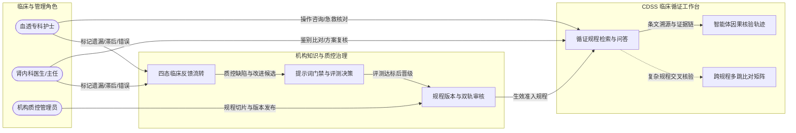
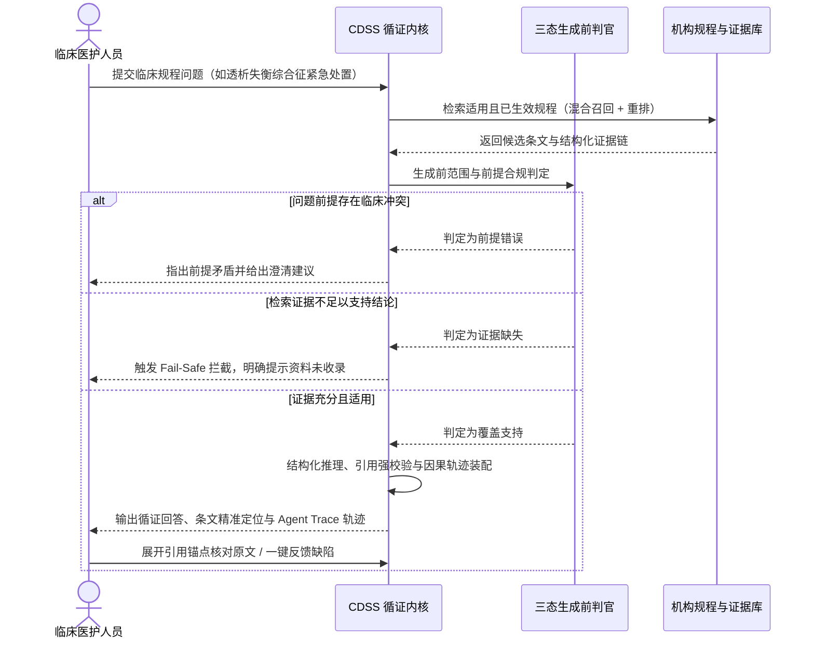
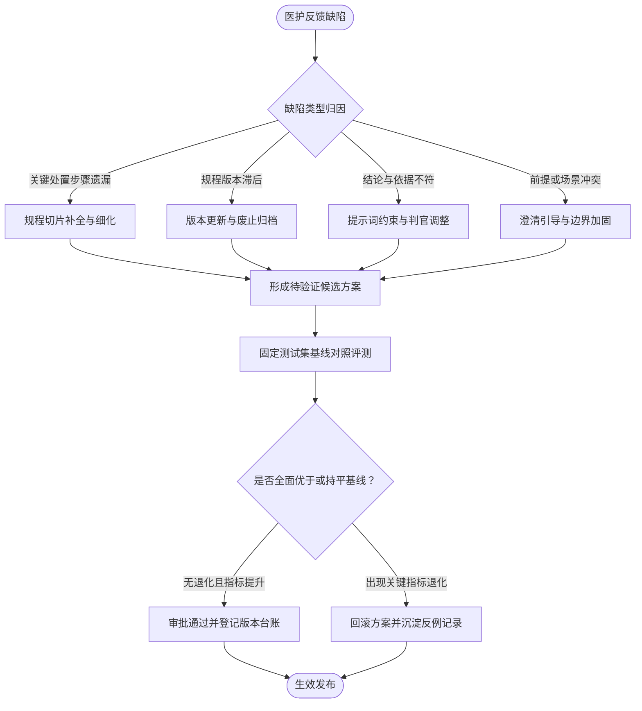

# 血液净化临床循证决策支持系统 (CDSS) ｜ 机构规程与质控服务

**面向血液净化中心与透析机构医护人员的专业知识与规程辅助系统：将分散的诊疗常规、急救规程与质控标准，转化为高置信、带条文级溯源、具备因果核验与跨规程比对的临床循证决策支持与工作问答。**

这是一份面向技术招聘方、工程评测团队与面试官的项目展示。项目由个人主导，AI 工具辅助实现、测试与文档整理；源码在私有仓库维护。

## 30 秒了解项目

血液透析是高风险、规程密集且伴随多并发症的临床治疗场景。医护人员在临床排班、应急处置、用药核对与质控检查中，经常面临规程散落多处、版本更新不一、适用人群限制严格等挑战。通用大模型在缺乏强证据约束时极易产生幻觉，或脱离临床适用条件给出不可靠建议。

系统围绕“循证依据可靠、决策因果可溯、知识生命可控”三项核心诉求构建：

| 临床与质控关注点 | CDSS 决策支持系统提供什么 | 核心技术与机制 |
| --- | --- | --- |
| 紧急与常规操作能否快速准确定位 | 自然语言输入、多轮会话上下文追问与专业实体识别 | 混合检索 + 分层语义重排 (Rerank) |
| 给出的处置步骤与数值依据在哪份文件 | 结构化回答提供条文级精准溯源、段落级高亮对齐 | 段落级精准锚点与引用硬约束校验器 |
| 复杂或跨规程场景是否存在条文差异 | 跨规程条文比对矩阵与多跳循证调查 | 离线 Investigation Agent 交叉比对 |
| 机器给出的决策建议是否具有可信依据 | 完整展示专科意图、证据链召回与判定因果关系 | 智能体因果核验轨迹 (Agent Trace) |
| 查不到规程或提问前提矛盾时如何处置 | 明确拦截，清晰告知资料不足或指出前提错误 | 三态生成前判官 (Fail-Safe 机制) |
| 规程修订后如何安全生效与闭环质控 | 多版本生命周期管理、四态临床反馈流与评测看板 | 双轨审核、提示词门禁与质量闭环 |

问答页在助手消息内展示阶段进度，完整核验后的回答在同一位置连续呈现；长答案按原文空行组织自然段，并保留原有标题、表格与列表。长代码与表格可限高预览并明确展开，上滚阅读后可用“回到底部”返回最新内容。手机窄屏采用单列布局，输入区和主要操作保持可用。复制、导出、引用核对和反馈仍使用完整原文，不通过删减内容改善排版。

## 产品能力全景

## 个人记忆与数据生命周期

个人记忆用于保存用户明确表达的工作背景、习惯和任务偏好，默认关闭，使用与学习分别由用户主动开启。记忆不是制度证据，不能替代规程原文；当前问题的明确要求与回答格式偏好始终优先。

- **可查看、可更正、可遗忘、可清空：** 用户可查看来源与有效期，单条遗忘或清空全部内容；旧来源不会自动重新学回。
- **可确认续期：** “确认仍有效”只延长保留时间，不改变记忆内容；召回本身不会续期。
- **可导出、可核对：** 用户可导出本人记忆，并查看最近删除、清理与导出回执；回执只显示时间、动作和数量，不显示正文。
- **逐答案透明：** 回答旁显示本轮是否使用个人记忆及具体条目；记忆失效时明确标记未使用。
- **会话级暂停：** 用户可关闭本会话学习，不影响已有记忆的召回与使用。
- **数据保护：** 记忆与备份采用加密存储，支持按用户隔离、保留期清理与无正文审计；不承诺对聊天历史、外部 Provider 日志或物理介质做统一擦除。

合成 UAT 已覆盖查看、确认、导出、审计、遗忘、清空、患者信息拦截、跨用户隔离、会话暂停、保留期清理和运维清理。

## 当前状态

截至 **2026-11-27**，生产运行版本为 `0f7ba35`。Agent 工程 UAT 完成 **1,779 项检查，1,779 PASS / 0 FAIL / 0 NOT RUN**；生产真实问答回归均返回带制度引用的正式回答，记忆、资料、登录与健康探针正常。用户已明确由机构负责人承担后果并放弃后续人工评审；本项目未做独立安全/隐私评审、真实人类临床 UAT 或临床签核，不宣称医学认证或临床有效性。

## 一次临床循证问答与因果核验如何发生

以下为虚构演示情境，不代表任何机构的真实诊疗规程：

| 模拟情境 | 预期系统表现 | 演示与验证关注点 |
| --- | --- | --- |
| 询问新员工动静脉内瘘穿刺规程与消毒标准 | 严格依据已生效规程作答，输出标准化操作步骤 | 展开引用锚点，核验原文条文与版本标识 |
| 继续追问“若出现穿刺处血肿，首要处置步骤与冷敷时机” | 结合前序内瘘上下文精准连贯追问 | 检查是否保持专科上下文，数值与时间有无偏差 |
| 询问未经收录的某罕见透析并发症报销比例 | 明确触发拒答与资料不足提示 | 坚决避免编造虚假百分比、杜绝伪造引用 |
| 询问“低血压休克时应立即加大超滤率吗” | 识别前提错误并进行纠错阻断 | 是否能识别危险操作前提并给出警示与依据 |

## 我做出的五个核心系统设计与产品取舍

**1. 坚守证据硬约束与段落级对齐。** 临床场景对准确性要求极高。系统放弃不可控的自由发散，所有结论严格锚定到规程段落；若最终输出包含未被证据证实的断言，引用校验器将强制阻断交付。

**2. 引入三态生成前判官（Fail-Safe 机制）。** 区别于传统的“不管能否回答都交给大模型自由发挥”，系统在生成前对证据覆盖度、缺失度及问题前提冲突进行三态判定，让“资料缺失”与“前提错误”提前受控拦截，大幅降低幻觉率与无效计算开销。

**3. 构建透明的智能体因果核验轨迹（Agent Trace）。** 医护人员面对 AI 建议时必须知其所以然。系统呈现专科意图分类、召回证据因果链与判官理由，使算法的内部决策流能够被专业临床人员直接审视与复核。

**4. 确定性在线流水线与离线多智能体分工。** 产品在线服务采用高可靠、低延迟的确定性流水线架构，不采用多 Agent 运行时编排；多智能体与 Harness 框架专职用于离线评测、对抗测试与跨规程多跳循证调查（Investigation Agent）。

**5. 建立严格的基线评测驱动决策闭环。** 拒绝以“感觉回答更通顺”作为上线标准。每一次提示词修订或召回模型优化，均需在冻结评测集上经过回答可用率、拒答准确率与引用有效率等多维指标的严谨对照。

## 从临床反馈到知识治理闭环

## 这份作品展现的核心能力

| 能力维度 | 面试可深入展开的工程与产品细节 |
| --- | --- |
| **临床业务理解** | 为什么规程问答必须做版本隔离、适用条件门禁、段落锚点与失败明确出口 |
| **AI 系统架构设计** | 混合检索配额控制、分层重排、三态判官、因果轨迹装配与引用校验器设计 |
| **可解释性与交互设计** | 如何通过 Agent Trace、条文比对抽屉与四态反馈降低医护人员认知负担 |
| **严谨评测与治理** | 为什么坚持冻结集对照、记录失败实验、区分字面召回与真实语义覆盖 |
| **端到端工程交付** | React 19 + FastAPI 全栈贯通、状态管理、无障碍合规、测试驱动开发与版本审计台账 |

个人主导的内容包括业务需求范围、产品流程、验收标准、算法方案取舍、系统架构设计与交付组织；AI 工具参与辅助编码、测试编写、根因诊断与材料初稿整理。面试时可结合具体提交记录与实机演示进一步展开。

## 当前进展与成果口径

更新日期：**2026-11-24**。

- 系统已完整实现：循证规程问答、段落级条文溯源、智能体因果核验轨迹 (Agent Trace)、跨规程条文比对抽屉、资料全生命周期管理、账号与角色权限、四态临床反馈流转、评测看板与操作审计。
- 问答页已加入助手消息内进度、核验后正文原位渐进呈现、自然段排版、长代码/表格限高展开与“回到底部”；完整原文仍用于复制、导出、引用核对和反馈，不通过删减内容改善排版。
- 个人记忆已具备查看、更正、确认续期、遗忘、清空、导出、无正文审计、逐答案使用透明、会话级暂停、保留期清理与加密备份；合成 UAT 16 项步骤通过，真实临床验收仍需机构与医护人员完成。
- 项目已有正式 **v0.1.4 发布与部署记录**；当前正在开展 **v0.1.5 发布候选评估**（涵盖 UI/文本全面高大上规范升级、Prompt 确定性缓存界定符治理与资料表响应式布局）。
- 设有完全原创虚构资料的确定性 Demo 路径，用于稳定演示核心功能与交互流程；真实模型调用链路按服务端配置受控启用。
- 历史评测涉及不同测试批次、模型基底与评分协议。本说明不把局部样本表现包装为“全系统准确率”，亦不虚构未经验证的商业收益或临床采纳指标。

> **合规与免责声明**：本系统定位于血液净化机构临床知识与规程检索辅助工具，作为临床决策支持（CDSS），不替代执业医师与临床护理人员的独立诊疗判断与操作许可；不作为生产级医疗认证系统。产品在线服务采用确定性流水线架构，不采用多 Agent 运行时编排。Demo 模式完全使用原创虚构资料，无需 Key、不访问网络；Cloud 模式需服务端显式自备 Key。

## 建议的 5 分钟展示顺序

1. **30 秒：** 说明血液净化临床规程为什么必须具备“带条文级溯源、可因果核验、可质控闭环”。
2. **90 秒：** 实机演示一次带段落级引用的循证回答、一次连贯追问以及 Agent Trace 轨迹展示。
3. **60 秒：** 演示跨规程多跳比对抽屉（Investigation Drawer）与三态判官的拒答拦截表现。
4. **60 秒：** 展示规程版本管理、四态临床反馈流转与评测决策看板，讲一个因指标退化而未采纳候选的真实取舍故事。
5. **60 秒：** 总结个人主导的架构决策、工程落地规范与下一步规划。

---
*注：本公开展示仓库仅同步 README.md 说明文档，不包含源码、真实病历/规程资料或数据库信息；详细工程实现与测试套件在私有源码仓库严格受控维护。*
